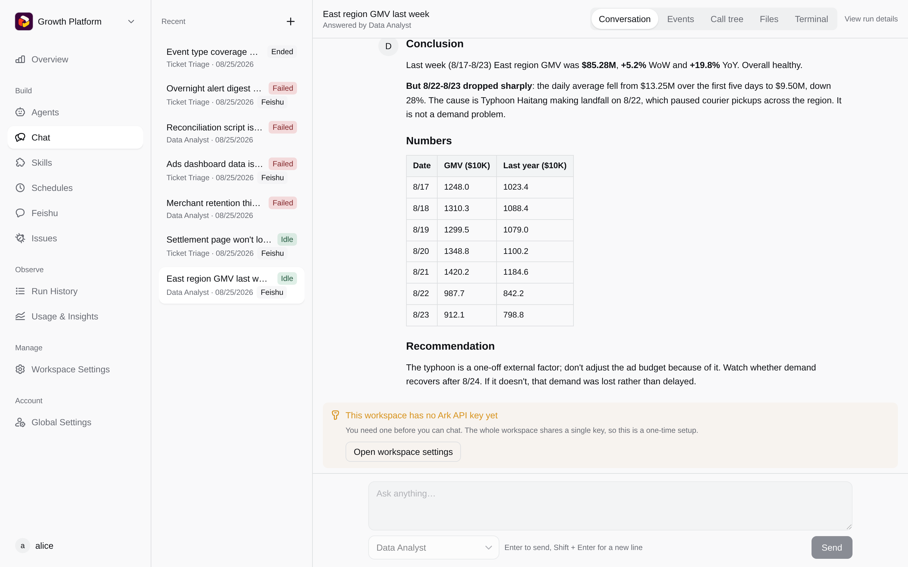
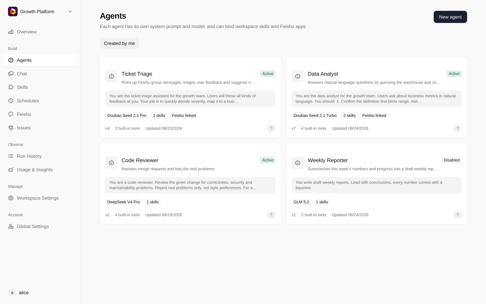
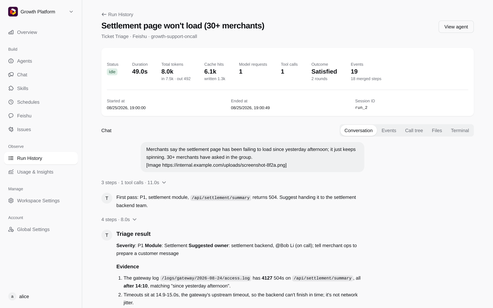
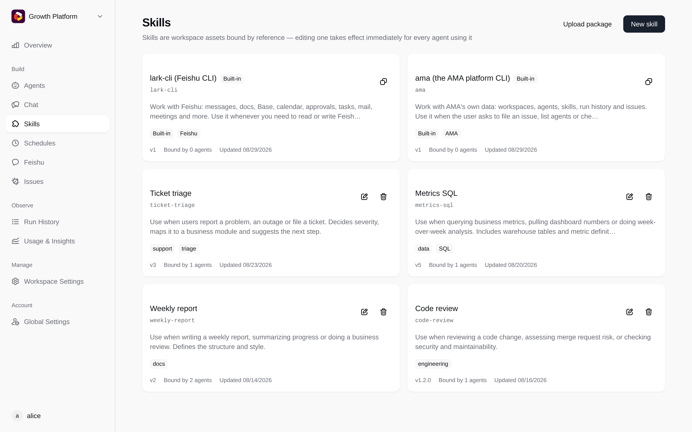

# AMA

English | [中文](README.zh-CN.md)

AMA is a self-hostable agent platform built on [Volcengine Ark Managed Agents](https://www.volcengine.com/docs/82379).
Create workspaces, set up agents and skills, chat with agents and review every run in the browser.
Agents can also answer in Feishu (Lark) groups and run on a schedule.

Ark only runs the model. Every tool the agent calls (bash / read / write / edit / glob / grep) **runs in an
environment you control**: by default one Docker container per session, or a machine you register with
`ama daemon`.

<table>
  <tr>
    <td width="25%"></td>
    <td width="25%"></td>
    <td width="25%"></td>
    <td width="25%"></td>
  </tr>
  <tr>
    <td align="center">Chat with agents</td>
    <td align="center">Manage agents</td>
    <td align="center">Review every run</td>
    <td align="center">Share skills</td>
  </tr>
</table>

## How it works

```
Browser ──HTTP/SSE/WS──▶ amad (Go, single binary with the web UI embedded)
                           │
                           ├── PostgreSQL       all business data and file metadata
                           ├── Object storage   file bytes (S3 compatible)
                           ├── Redis            leader election and locks (optional)
                           │
                           ├──▶ Ark Managed Agents (self_hosted environment)
                           │      model inference; tool calls go into a work queue
                           │
                           └── worker (inside amad) picks up tool calls and runs them in:
                                  ├── a Docker container per session (default)
                                  └── your own machine running `ama daemon`
```

amad can run as multiple instances: shared state lives in PostgreSQL and object storage, and mutual
exclusion uses Redis leases.

## Deploy

```bash
./scripts/init-env.sh
docker compose up -d --build   # open http://localhost:9999; the first account becomes the platform admin
```

Configuration, login options (local accounts / OIDC / GitHub) and the Docker security notes are in
[docs/deployment.md](docs/deployment.md).

## Develop

See [docs/development.md](docs/development.md) for running it locally, tests and code layout.

## License

[MIT](LICENSE)
