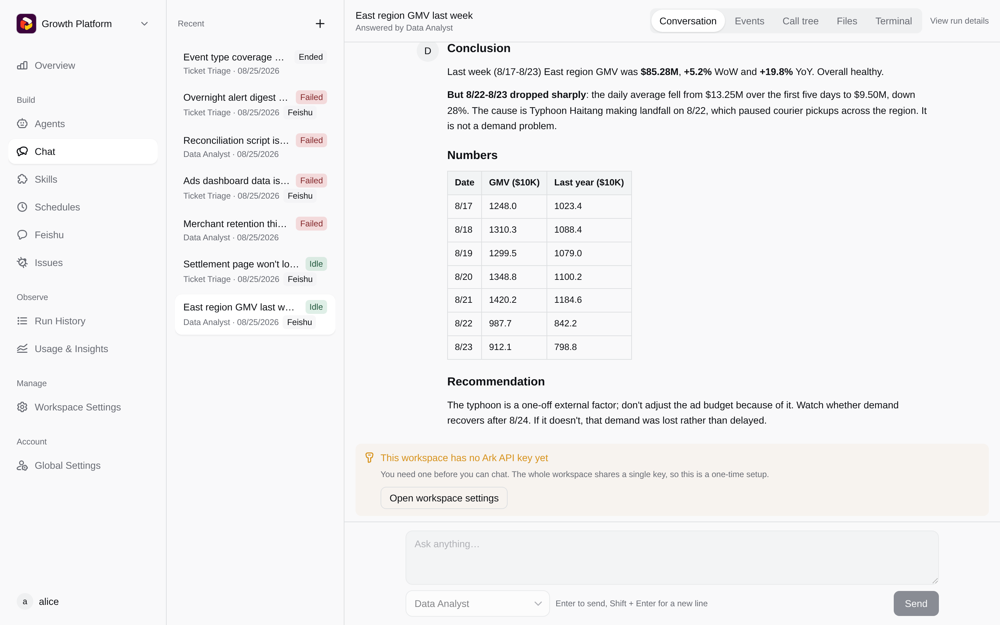
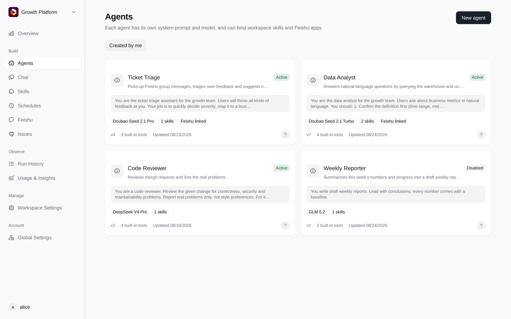
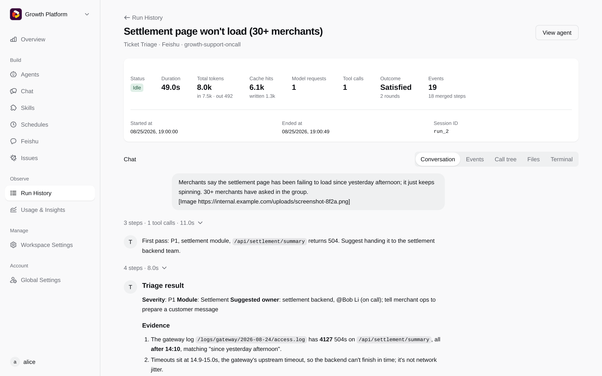
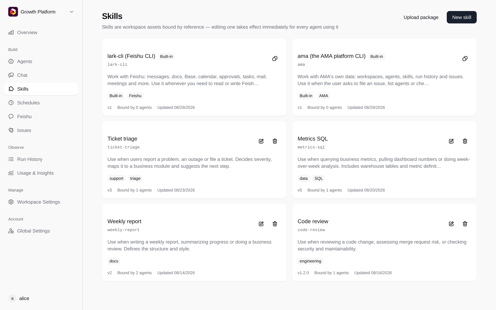

# AMA

[English](README.md) | 中文

AMA 是一个可以自己部署的 agent 平台，构建在[火山方舟 Managed Agents](https://www.volcengine.com/docs/82379) 之上。
在网页上建空间、配 agent 与技能、和 agent 对话、回看每一次运行；也可以把 agent 接进飞书群、扫码接进微信、配定时任务。

方舟只负责模型推理；agent 调用的工具（bash / read / write / edit / glob / grep）**跑在你自己的执行环境里**：
默认是每个会话一个 Docker 容器，也可以是你用 `ama daemon` 注册的一台机器。

<table>
  <tr>
    <td width="25%"></td>
    <td width="25%"></td>
    <td width="25%"></td>
    <td width="25%"></td>
  </tr>
  <tr>
    <td align="center">和 agent 对话</td>
    <td align="center">管理 agent</td>
    <td align="center">回看每次运行</td>
    <td align="center">共用技能</td>
  </tr>
</table>

## 怎么工作的

```
浏览器 ──HTTP/SSE/WS──▶ amad（Go，单二进制，前端产物嵌在里面）
                          │
                          ├── PostgreSQL   全部业务数据与文件元信息
                          ├── 对象存储      文件字节（S3 兼容）
                          ├── Redis        选主与抢锁（可选）
                          │
                          ├──▶ 方舟 Managed Agents（self_hosted 环境）
                          │      模型推理；工具调用进 work 队列
                          │
                          └── worker（amad 内）领走工具调用，在这里执行：
                                 ├── 每个会话一个 Docker 容器（默认）
                                 └── 跑着 `ama daemon` 的自带机器
```

amad 可以多实例部署：共享状态在 PostgreSQL 与对象存储里，互斥靠 Redis 租约。

## 部署

```bash
./scripts/init-env.sh
docker compose up -d --build   # 打开 http://localhost:9999，第一个注册的账号自动成为平台管理员
```

配置项、登录方式（本地账号 / OIDC / GitHub）与 Docker 执行端的安全提醒见 [docs/deployment.zh-CN.md](docs/deployment.zh-CN.md)。

## 开发

本地跑起来、测试与目录结构见 [docs/development.zh-CN.md](docs/development.zh-CN.md)。

## License

[MIT](LICENSE)
